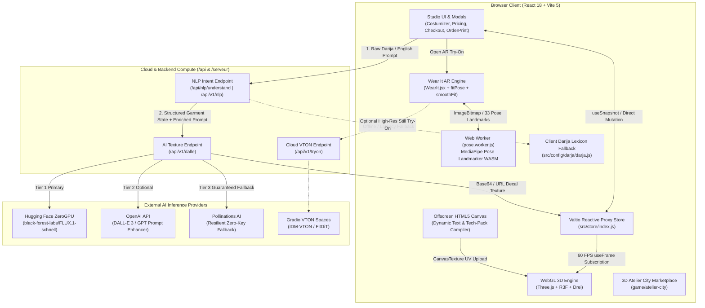
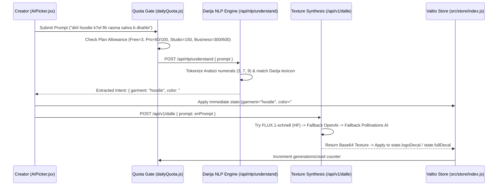

# Designili — Technical Architecture & System Specifications

**Repository:** [https://github.com/fouad3966/Thirduni---Designili](https://github.com/fouad3966/Thirduni---Designili)  
**Live Deployment:** [https://thirduni-designili.vercel.app](https://thirduni-designili.vercel.app)  
**Target Audience:** Software Architects, Technical Judges, 3D WebGL Engineers, and AI/CV Evaluators.

## 1. Executive Technical Summary

**Designili** is a browser-native 3D garment engineering studio, cultural NLP design synthesizer, real-time WebAssembly AR fitting system, virtual 3D storefront marketplace, and localized Algerian print-on-demand commerce platform.

To deliver a zero-install, 60 FPS experience on consumer laptops and mobile browsers, the architecture enforces four core engineering principles:

1. **Zero-Re-Render 3D State Synchronization:** High-frequency 3D mesh mutations (color interpolation, UV decal transforms, procedural fabric normal maps, and camera rigs) are driven by a reactive **Valtio** proxy store (`src/store/index.js`) read directly inside React Three Fiber's `useFrame` WebGL render loop—bypassing React virtual DOM reconciliation during active 3D manipulation.
2. **Off-Main-Thread Computer Vision (AR Try-On):** Live webcam body tracking (`src/tryon/`) executes **Google MediaPipe Pose Landmarker Lite (WASM)** inside an isolated **Web Worker** (`pose.worker.js`), keeping the main UI and WebGL threads unblocked while maintaining 30+ FPS pose estimation and zero server video transmission.
3. **Dual-Runtime Resilient AI & Cultural NLP Pipeline:** Natural language prompts in **Algerian Darija (Arabizi)**, **Arabic**, and **English** are parsed through a deterministic phonetic/lexicon intent engine (`src/config/darja/darja.js`, `/api/nlp.js`, and `/serveur/services/darja.js`) before dispatching to a multi-tier generative image pipeline (**FLUX.1-schnell** on Hugging Face ZeroGPU → **OpenAI DALL-E** → **Pollinations AI** zero-key fallback).
4. **Dual-Backend Cloud Parity:** Every API route is implemented in both **Vercel Serverless Functions** (`/api/`) for instant edge deployment and a standalone **Node.js + Express** microservice (`/serveur/`) for dedicated container hosting.

## 2. High-Level System Topology

## 3. Module-by-Module Technical Breakdown

### 3.1 Reactive State Layer (`src/store/index.js`)

Unlike Redux or React Context, which propagate state updates top-down through React component trees, Designili uses **Valtio** (`proxy` and `useSnapshot`) to separate **UI reactivity** from **WebGL frame-loop reactivity**:

| State Slice | Key Properties | Architectural Role |
| :--- | :--- | :--- |
| **Viewport & Routing** | `intro`, `preview`, `wearItOpen`, `activeEditorTab` | Controls view transitions between `Home.jsx`, `Costumizer.jsx`, `WearIt.jsx`, and studio tool docks without router reloads. |
| **3D Garment & PBR Mesh** | `garment`, `color`, `trimColor`, `useTrim`, `fabricType`, `modelRotation` | Drives active GLB/procedural mesh selection (`tshirt`, `hoodie`, `dress`, `suit`, `caftan`, `karakou`, `shoes`) and material properties. |
| **Decal & UV Projection** | `isLogoTexture`, `isFullTexture`, `logoDecal`, `fullDecal`, `logoScale`, `logoPosition`, `logoRotation`, `logoTargetMesh` | Controls chest logo decals and seamless full-garment pattern textures across multi-part 3D meshes. |
| **3D Typography Engine** | `isTextTexture`, `textContent`, `textColor`, `textFont`, `textSize`, `textScale`, `textPosition`, `textRotation` | Synchronizes live user text input with an offscreen 2D canvas that uploads a dynamic `THREE.CanvasTexture` onto curved 3D geometry. |
| **Commercial & Tier State** | `currentPlan`, `billingCycle`, `currency`, `generationsUsed`, `brandKit`, `currentOrder` | Manages active subscription tier (`free`, `pro`, `studio`, `business`, `business_plus`), quota enforcement, saved company brand kits, and print-shop order state. |
| **Modal Orchestration** | `pricingModalOpen`, `checkoutModalOpen`, `orderModalOpen`, `exportModalOpen`, `judgeDemoBarOpen` | Coordinates glassmorphic studio overlays for pricing comparison, Edahabia/CIB checkout, Wilaya print-shop ordering, and judge evaluation controls. |

### 3.2 3D WebGL Viewport & Procedural Material Pipeline (`src/canvas/`)

The 3D studio is engineered on **Three.js (`0.165`)**, **React Three Fiber (`@react-three/fiber`)**, and **React Three Drei (`@react-three/drei`)**:

1. **Multi-Garment Mesh Architecture (`Shirt.jsx` & `Garment.jsx`):**
   * `Shirt.jsx` manages the primary T-shirt mesh with independent material groups for the main body fabric and collar/sleeve trims (`useTrim`, `trimColor`).
   * `Garment.jsx` generalizes mesh loading and procedural geometry fallback for complex garments including **Hoodies, Evening Dresses, Tailored Suits, Algerian Caftans, Traditional Karakous, and Footwear**.
   * Frame-level color transitions use `maath/easing` (`easing.dampC`) inside `useFrame((state, delta) => ...)` to interpolate diffuse material colors smoothly at 60 FPS.
2. **Procedural Fabric Normal & Roughness Synthesis (`src/config/fabricTexture.js`):**
   * Rather than downloading heavy external 4K PBR texture maps that stall initial page load, `fabricTexture.js` procedurally synthesizes tileable **Normal Maps** and **Roughness Maps** in-memory on an HTML5 `<canvas>` for different textile weaves (cotton jersey, heavy fleece, silk satin, structured brocade/velvet for Karakou/Caftan).
3. **UV Decal Bounding & Masking (`src/config/logoMask.js` & `GarmentTextDecal.jsx`):**
   * `logoMask.js` clips uploaded or AI-generated chest graphics against configurable geometric masks and UV boundaries so decals never bleed across garment seams or inner collars.
   * `useTextTexture.js` and `textTexture.js` rasterize multi-font typography (supporting Latin and Arabic/Darija glyphs) onto an offscreen canvas with transparent alpha channels and bind the resulting texture to a `<Decal />` projection mesh.
4. **Studio Lighting & Camera Rig (`CameraRig.jsx`, `BackDrop.jsx`, `ModelRotator.jsx`):**
   * `CameraRig.jsx` applies pointer-parallax damping (`easing.dampE`) and smooth zoom transitions.
   * `BackDrop.jsx` renders `<AccumulativeShadows>` and dual `<RandomizedLight>` rigs tuned to prevent highlight clipping on bright white or metallic gold decals.

### 3.3 Algerian Darija (Arabizi) NLP & Multi-Tier AI Pipeline (`src/config/darja/`, `api/`, `serveur/`)

A core technical differentiator of Designili is its ability to understand **Algerian Darija written in Latin script (Arabizi)** alongside Arabic and English.

* **Deterministic Cultural Lexicon (`src/config/darja/darja.js` & `serveur/services/darja.js`):**
  * Handles Algerian Arabizi phonetic numerals (`3` = ع, `7` = ح, `9` = ق, `5` = خ) and orthographic variations (e.g., `k7el` / `khal` / `akhal` → `#111827` Jet Black; `zra9` / `zrag` → Royal Blue; `dhahbi` → Metallic Gold; `triko` → T-Shirt; `tricou b capuche` → Hoodie; `karakou` → Karakou).
  * Extracts **4 structured dimensions** from a single conversational sentence:
    1. **Target Garment Mesh** (`tshirt`, `hoodie`, `dress`, `suit`, `caftan`, `karakou`)
    2. **Base Fabric & Trim Hex Colors** (`color`, `trimColor`)
    3. **Application Mode** (`logo` chest emblem vs. `full` seamless all-over textile pattern)
    4. **Enriched English Diffusion Prompt** (appending lighting, isolated vector/textile constraints, and cultural motif descriptors for the image generator).
* **Three-Tier Resilient Image Synthesis (`api/dalle.js` & `serveur/route/dalle.routes.js`):**
  * **Tier 1 (Primary):** Queries `black-forest-labs/FLUX.1-schnell` via `@gradio/client` / Hugging Face Inference API for fast, high-detail textile and emblem generation.
  * **Tier 2 (Optional Commercial):** Uses OpenAI `DALL-E` when `OPENAI_API_KEY` is configured in the environment.
  * **Tier 3 (Guaranteed Zero-Downtime Fallback):** Automatically fails over to **Pollinations AI** (returning a base64-encoded data URI via serverless fetch) if free Hugging Face GPU quotas are rate-limited during live hackathon judging.

### 3.4 Real-Time In-Browser AR Virtual Try-On (`src/tryon/`)

The **Wear It** system (`src/tryon/WearIt.jsx`) allows users to preview their customized 3D garment on their live webcam feed without uploading private camera frames to an external server:

1. **WebGL Snapshot Capture:** When the user opens `WearIt.jsx`, the current customized 3D garment is captured from the Three.js canvas with a transparent alpha background (`preserveDrawingBuffer: true`).
2. **Isolated Web Worker Pose Tracking (`poseTracker.js` & `pose.worker.js`):**
   * Video frames from `navigator.mediaDevices.getUserMedia` are transferred to `pose.worker.js`, which initializes **MediaPipe Pose Landmarker Lite (WASM)**.
   * Running inference inside a dedicated worker ensures that pose detection never drops frames in the main UI or 3D rendering thread.
3. **Biomechanical Torso Projection (`fitPose.js`):**
   * Computes shoulder width, torso length, center-of-chest anchor, and 2D roll angle from MediaPipe landmarks `11` (left shoulder), `12` (right shoulder), `23` (left hip), and `24` (right hip).
   * Calculates an affine transformation matrix that scales, rotates, and warps the garment snapshot to match the user's posture and distance from the camera.
4. **Temporal Kalman / EMA Smoothing (`smoothFit.js`):**
   * Raw webcam pose landmarks exhibit high-frequency pixel jitter. `smoothFit.js` applies adaptive velocity-aware exponential moving average (EMA) filtering so the garment locks solidly onto the user's torso during movement.
5. **Limb & Chin Depth Occlusion (`occlusion.js`):**
   * Uses forearm, wrist, and face landmarks (`13–16`, `0–10`) to construct a dynamic foreground mask so that when a user crosses their arms in front of their chest, their arms naturally occlude the garment layer.

### 3.5 3D Atelier City Marketplace (`game/atelier-city/`)

Located in `game/atelier-city/`, the marketplace extends Designili from a single-player creation tool into a **community ecosystem**:

* Provides an interactive 3D street-level district where creators and shoppers can walk through virtual boutiques, inspect designs published by other community stores, get inspired by trending local aesthetics, and launch directly into the customizer or order flow.

### 3.6 Commercial Engine, Tech-Pack Compiler & Judge Demo Architecture

To bridge creative design with physical manufacturing in Algeria (`Financial Plan - October 2026`), the frontend implements a complete commercial and production workflow:

1. **Automated Factory Tech-Pack & Spec Sheet Compiler (`src/config/exportSpecSheet.js` & `src/comp/ExportModal.jsx`):**
   * Generates a multi-panel technical specification sheet on a high-resolution HTML5 canvas containing:
     * Front/view render of the customized garment
     * Exact **HEX & RGB color swatches** for base fabric and trim
     * Fabric type and GSM/weave metadata
     * Embedded decal/artwork assets, placement coordinates, scale percentages, and typography specifications
   * Enforces tier gating: direct `PNG / SVG / PDF` export for outside printers is unlocked strictly on **Studio** (`$19 / 2,550 DA`) and **Business Plus** (`$79 / 10,600 DA`) plans to protect the platform's 15% partner print-shop commission on lower tiers.
2. **Algerian Subscription Checkout Prototype (`src/comp/PricingModal.jsx` & `src/comp/SubscriptionCheckoutModal.jsx`):**
   * Implements dual-currency (`1 USD = 134 DA`) monthly and annual billing across all 5 plans (**Free, Pro, Studio, Business, Business Plus**).
   * Simulates localized **Edahabia (Algérie Poste)** and **CIB (SATIM Interbank)** card validation and SMS OTP verification alongside **International Mastercard**.
   * Enforces the mandatory transparency notice across Pricing, Export, and Order views: *"Your plan covers the design tools. The garment and printing are paid separately to the print shop you choose."*
3. **58-Wilaya Partner Print-Shop Routing & Order Tracker (`src/comp/OrderPrintModal.jsx`):**
   * Matches the customer's selected **Wilaya** with verified regional printing and sewing workshops, supporting both single-piece individual orders (average `3,000 DA / $22.40`) and **B2B multi-size bulk matrices (`XS–XXL`)** for **Business** and **Business Plus** accounts (average `40,200 DA / $300`).
   * Models **Cash on Delivery (COD)** paid directly to the print shop while transparently calculating Designili's **15% B2B partner commission** (`450 DA` on average individual orders; `6,030 DA` on average company bulk orders) and tracking the 4 production stages (`Received → Printing → Shipped → Delivered`).
4. **Hackathon Judge Demo Bar (`src/comp/JudgeDemoBar.jsx`):**
   * Provides evaluators with a non-intrusive floating control center to switch between all 5 subscription tiers in real time, reset `localStorage` AI quotas (`src/config/dailyQuota.js`), and inspect per-plan unit margins (51%–77%) and Year 1 financial projections (`$19,241 / 2,578,300 DA` revenue, Month 3 profitability).

## 4. Architectural Decision Records (ADRs)

| ADR ID | Decision Title | Context & Problem | Chosen Solution & Technical Rationale |
| :--- | :--- | :--- | :--- |
| **ADR-001** | **WebGL PBR 3D Simulation over 2D Static Mockups** | Flat 2D T-shirt overlays fail to convey garment drape, curved decal wrapping, or traditional Algerian silhouettes (Caftan, Karakou). | Built a **Three.js + React Three Fiber** viewport with procedural fabric normal maps (`fabricTexture.js`) and 3D `<Decal />` mesh projection for true 360° inspection. |
| **ADR-002** | **Valtio Proxy State over Redux / Context** | Continuous color picker dragging and 3D decal scaling at 60Hz cause severe frame drops if routed through React component tree re-renders. | Adopted **Valtio** (`src/store/index.js`) so R3F's `useFrame` loop reads mutable proxy state directly at 60 FPS while UI panels subscribe selectively via `useSnapshot`. |
| **ADR-003** | **Multi-Tier Resilient AI Synthesis** | Free GPU inference spaces (Hugging Face ZeroGPU) have variable queues that can time out during live hackathon judging. | Implemented a 3-tier cascading gateway (`/api/dalle.js`) that attempts **FLUX.1-schnell**, checks **OpenAI DALL-E**, and guarantees completion via **Pollinations AI**. |
| **ADR-004** | **In-Browser WebAssembly MediaPipe Pose Tracking** | Server-side virtual try-on models (IDM-VTON / FitDiT) take 10–30 seconds per static photo, have non-commercial license limits, and incur high GPU costs. | Engineered client-side **MediaPipe Pose Landmarker Lite** in a **Web Worker** (`pose.worker.js`) with Kalman smoothing (`smoothFit.js`) for 30+ FPS live AR fitting at **$0.00 server cost per user**. |
| **ADR-005** | **Deterministic Darija / Arabizi Cultural NLP Engine** | Algerian users naturally mix French, Arabic, and numbered Arabizi (`3`, `7`, `9`) when describing clothes, which confuses generic English image models. | Created a dual-runtime phonetic lexicon and intent parser (`src/config/darja/darja.js` & `/api/nlp.js`) that deterministically extracts garment type, hex colors, and placement while translating cultural motifs into high-precision diffusion prompts. |
| **ADR-006** | **Dual Serverless (`/api`) & Express (`/serveur`) Parity** | Judges need a zero-cold-start live URL on Vercel, while enterprise/local deployments benefit from a stateful Node.js/Express + MongoDB backend. | Mirrored core AI and NLP handlers in both Vercel Serverless Functions (`/api/dalle.js`, `/api/nlp.js` via `vercel.json` rewrites) and the standalone Express server (`/serveur/`). |
| **ADR-007** | **Two-Sided Print-Shop Commission & Tier-Gated Export** | Handling physical garment payments and shipping escrow directly creates heavy working-capital and logistics risk for an early-stage platform. | Separated revenue streams: subscriptions cover design tools (**Edahabia / CIB / Mastercard**), while garments and printing are paid via **Cash on Delivery** directly to partner print shops (who pay Designili a **15% monthly invoice commission**). Outside tech-pack exports (`PNG/SVG/PDF`) are gated to higher-priced **Studio** and **Business Plus** tiers to offset zero print commission. |