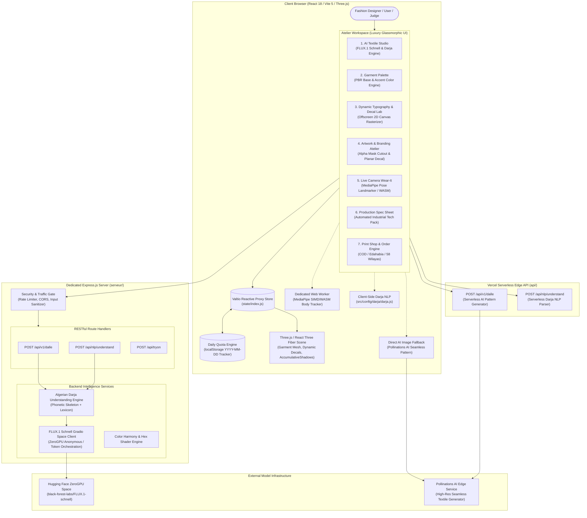
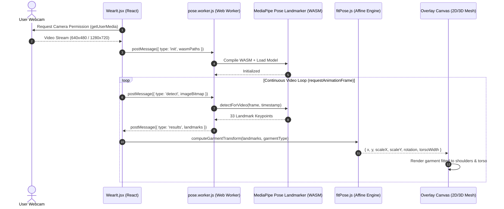

# DESIGNILI 3D STUDIO — Technical Architecture & System Specifications

> **Target Audience**: Senior System Architects, Technical Recruiters, Hackathon Judges, and 3D/AI Evaluators.  
> **Purpose**: Detailed technical blueprint, architectural decision records (ADRs), mathematical formulations, cultural NLP pipeline specifications, computer vision try-on architecture, and commercial engine specifications for the Designili 3D Garment Customizer platform.

---

## 1. System Overview & Core Philosophy

**Designili 3D Studio** is an enterprise-grade, browser-native fashion engineering platform. It bridges generative AI, computational linguistics, real-time 3D Physically Based Rendering (PBR), on-device computer vision, and an integrated Algerian print-on-demand manufacturing pipeline.

Traditional apparel customization workflows force creators to juggle fragmented tools:
- 2D raster applications (Photoshop/Illustrator) producing flat graphics that ignore seam geometry, fabric drape, and back-of-garment inspection.
- Workstation CAD suites (Clo3D, Marvelous Designer) requiring dedicated GPUs, expensive enterprise licenses, and months of specialized training.
- Off-the-shelf text-to-image models that generate photographs of human models rather than flat, production-ready textile prints.
- Disconnect from local manufacturing and domestic payment mechanisms (such as Cash-on-Delivery, Edahabia, and CIB across Algerian wilayas).

Designili unifies these domains into a browser-native atelier operating across **two complementary runtimes**:
1. **Cloud Serverless Runtime (Vercel)**: Serverless edge functions (`api/dalle.js`, `api/nlp.js`) with instant client-side AI fallback (Pollinations AI) and Content Security Policy (CSP) headers tailored for WebAssembly and Web Worker execution.
2. **Dedicated Full-Stack Runtime (Node.js 22 + Express)**: Standalone REST API gateway in `serveur/` orchestrating Hugging Face ZeroGPU Spaces (`black-forest-labs/FLUX.1-schnell`) via Gradio WebSocket RPC.



---

## 2. Architectural Decision Records (ADRs)

### ADR 001: WebGL 3D Garment Mesh Simulation vs. 2D Canvas Mockups
- **Context**: Standard e-commerce apparel customizers overlay flat PNG stickers onto static 2D product photos. This produces lifeless graphics that ignore fabric folds, light falloff, seam geometry, and back-of-garment inspection.
- **Decision**: Adopt **Three.js** and **React Three Fiber (`@react-three/fiber`)** with **React Three Drei (`@react-three/drei`)**.
- **Consequences**:
  - Full 360° interactive orbit, pan, and tilt with responsive touch/mouse controls.
  - Multi-garment catalog: T-Shirt (`shirt_baked.glb`), Hoodie (`hoodie/model.glb`), Evening Dress (`dress/model.glb`), Suit (`suit/model.glb`), Caftan, and Karakou.
  - Physically Based Rendering (PBR) materials reacting naturally to studio lighting and soft contact shadows (`AccumulativeShadows`).

### ADR 002: Valtio Reactive Proxy State vs. Redux / Zustand
- **Context**: 3D view manipulation involves 60fps continuous mouse dragging (`shirtRotationY`), real-time camera interpolation, dynamic text rasterization, and rapid color changes.
- **Decision**: Adopt **Valtio** proxy state (`src/store/index.js`).
- **Consequences**:
  - Fine-grained reactivity without boilerplate selectors or unnecessary component tree re-renders.
  - Mutations are direct (`state.color = newColor; state.shirtRotationY += deltaX`).
  - Seamless integration with Three.js render loops (`useSnapshot(state)`).
  - Snapshot-based historical state persistence (`src/config/designHistory.js`) for undo/redo and lookbook revision switching.

### ADR 003: Multi-Tier Resilient AI Textile Synthesis (FLUX.1 Schnell & Pollinations AI)
- **Context**: Commercial diffusion APIs (Midjourney, DALL-E 3) incur per-call subscription fees and require credit cards. On the other hand, serverless environments like Vercel have execution timeouts (10–30s) and cannot maintain long-lived Python WebSocket sessions.
- **Decision**: Implement a two-tier generative architecture:
  1. *Primary (Dedicated Server)*: Connect to public **Hugging Face ZeroGPU Spaces** (`black-forest-labs/FLUX.1-schnell`) via WebSocket/Gradio RPC (`serveur/services/huggingface.js`).
  2. *Secondary / Serverless (Vercel & Client)*: High-resolution (1024×1024) seamless textile pattern generation via `api/dalle.js` with direct client-side fallback to Pollinations AI.
- **Consequences**:
  - Zero mandatory API costs for visitors and prototype evaluators.
  - High availability: if the dedicated backend or Hugging Face queue is busy, the client automatically generates the pattern directly and updates the 3D canvas without failing.

### ADR 004: In-Browser MediaPipe WebAssembly Pose Tracking vs. Cloud Neural Try-On
- **Context**: Cloud virtual try-on pipelines (IDM-VTON, Cat-VTON) require high-end server GPUs, introduce 10–25s latency, and require uploading sensitive webcam video to remote servers.
- **Decision**: Deploy **Google MediaPipe Pose Landmarker Lite** client-side via WebAssembly (WASM) and SIMD running in a dedicated **Web Worker** (`src/tryon/pose.worker.js`).
- **Consequences**:
  - Real-time 30+ FPS interactive fitting directly on the user's device.
  - Zero server GPU cost and 100% user biometric privacy (video frames never leave browser memory).
  - Operates offline or over low-bandwidth mobile connections.

### ADR 005: Dual-Runtime Algerian Darja & Arabizi Cultural NLP Engine
- **Context**: North African designers express design concepts in **Darja** using Latin script (Arabizi / 3arbizi, e.g. `"tshirt k7al fih zellij dahabi"`). Off-the-shelf translators fail to interpret dialect words, numeral substitutions (`3` for ع, `7` for ح), and cultural terms.
- **Decision**: Build a deterministic phonetic lexicon and normalizer available in both runtimes:
  - Client-side: `src/config/darja/darja.js` and `colors.js`.
  - Server-side: `api/nlp.js` and `serveur/services/darja.js`.
- **Consequences**:
  - Instantaneous translation with zero latency.
  - Fully offline capability—no reliance on third-party translation APIs.
  - Support for colloquial terms like `gat` (cat), `mna9et` (polka dots), and heritage elements (`zellij`, `karakou`, `tassili`).

### ADR 006: Calendar-Date LocalStorage Quota Enforcement & Sandbox Evaluation Engine
- **Context**: The prototype free tier provides 3 AI generations per day. Storing quota purely in memory resets on browser refresh, while requiring a central database forces account creation and delays evaluation during hackathons and demonstrations.
- **Decision**: Implement `src/config/dailyQuota.js`:
  - Tracks `{ date: 'YYYY-MM-DD', count: number }` in `localStorage`.
  - Automatically resets to `0/3` when the local calendar day changes (at midnight).
  - Provides a **"Reset Demo Quota"** button in `AIPicker.jsx` and `JudgeDemoBar.jsx` so evaluators and testers can test freely without being permanently locked out.

### ADR 007: Algerian E-Commerce & Print-Shop Production Engine
- **Context**: Fashion merchandising in Algeria relies heavily on domestic payment methods (Edahabia cards, CIB) and Cash-on-Delivery (COD) paid to partner print shops upon receiving physical garments across 58 wilayas.
- **Decision**: Build an integrated e-commerce and order dispatch prototype:
  - Partner print-shop selector by wilaya (Oran Print Hub, Alger Sublimation, Constantine TechPrint).
  - Dual-currency pricing model (DA and USD at the official rate: 1 USD = 134 DA).
  - Simulated Edahabia/CIB checkout with OTP verification and live order status progression (Received $\rightarrow$ Printing $\rightarrow$ Shipped $\rightarrow$ Delivered).

---

## 3. Generative AI Pipeline & Prompt Architecture

### The "Fabric vs. Photo" Problem
Standard text-to-image prompts given to models like DALL-E or Midjourney yield a photo of a human model standing in a studio wearing a garment. This cannot be mapped onto a 3D UV mesh.

Designili intercepts every prompt and reshapes it through the textile art-direction pipeline:

```
[Raw User Input] (e.g., "bghit hoodie kahla b zellij dahabi")
       │
       ▼
[Darja Cultural NLP] ──► Extracted: Motif="geometric zellige mosaic tile", Colors=["#0B0B0B", "#D4AF37"]
       │
       ▼
[Textile Art Direction Synthesis]
"Flat edge-to-edge seamless textile artwork of geometric zellige mosaic tile motifs,
 deep black background (#0B0B0B) with metallic gold accents (#D4AF37),
 symmetrical North African ornament, top-down flat fabric print,
 high-resolution vector surface pattern, no models, no mockups, no folds."
       │
       ▼
[Generative AI Synthesis (FLUX.1 Schnell / Pollinations Fallback)]
       │
       ▼
[1024x1024 Base64 Image Delivery + Dominant Color Extraction]
       │
       ▼
[Three.js Material Texture Mapping & Collar/Cuff Accent Tinting]
```

---

## 4. 3D Graphics Simulation & Mathematics

### 4.1 Planar Decal Projection Math
Decals are projected onto arbitrary 3D geometry using the Drei `Decal` primitive. A virtual projection box is placed at position $\mathbf{P} \in \mathbb{R}^3$, oriented along normal vector $\mathbf{N} \in \mathbb{R}^3$, with scale $\mathbf{S} = (s_x, s_y, s_z)$ and rotation angle $\theta$:

$$\mathbf{M}_{\text{proj}} = \mathbf{T}(\mathbf{P}) \cdot \mathbf{R}(\mathbf{N}, \theta) \cdot \mathbf{S}(s_x, s_y, s_z)$$

Points on the garment surface intersecting this bounding volume are clipped and projected onto a planar UV coordinate frame:

$$u = \frac{\mathbf{v}_{\text{local}} \cdot \hat{\mathbf{x}}}{s_x} + 0.5, \quad v = \frac{\mathbf{v}_{\text{local}} \cdot \hat{\mathbf{y}}}{s_y} + 0.5$$

Where $(u, v) \in [0, 1]^2$.

### 4.2 Dynamic 2D Offscreen Canvas Text Decal Rasterization
To provide crisp typography on 3D garments without pre-rendering static bitmaps:
1. An offscreen 2D `<canvas>` element (typically 1024×512 or 2048×1024) is initialized in `src/config/textTexture.js`.
2. Canvas styles (font face, weight, tracking, drop shadows, curved text, screenprint effects, and multi-line alignment) are rendered dynamically.
3. The canvas is bound to a Three.js `CanvasTexture` (`needsUpdate = true`).
4. The texture is fed into a secondary `Decal` or mapped directly to the garment's front/back chest target coordinates.

### 4.3 Color Harmony & Perceptual Color Matching (`palette.js`)
When an AI textile is generated, Designili analyzes whether the AI adhered to the user's requested palette:
1. Samples pixel clusters using an offscreen canvas.
2. Converts RGB colors to CIE $L^*a^*b^*$ color space.
3. Computes the perceptual color difference using the Euclidean CIE76 $\Delta E^*_{ab}$ metric:

$$\Delta E^*_{ab} = \sqrt{(L^*_2 - L^*_1)^2 + (a^*_2 - a^*_1)^2 + (b^*_2 - b^*_1)^2}$$

If $\Delta E > 25$, the UI offers a one-click **"Match My Colors"** feature that remaps textile hues directly to the user's requested palette.

---

## 5. Cultural NLP Engine: Algerian Darja & Arabizi

The engine in `src/config/darja/darja.js` parses Algerian Arabic in both Arabic script and Latin Arabizi (numbers representing phonemes: `3` = ع, `7` = ح, `9` = ق, `5` = خ).

### 5.1 Pipeline Stages
1. **Unicode Normalization (NFKC)**: Strips harakat (tashkeel), tatweel, and normalizes Arabic-Indic digits (`٠-٩` $\rightarrow$ `0-9`).
2. **Repetition Collapsing**: Collapses exaggerated letter repetitions (`"kahlaaaa"` $\rightarrow$ `"kahlaa"`).
3. **Phonetic Folding**: Unifies regional spelling variants (`"ڨ"`, `"ڤ"`, `"چ"` $\rightarrow$ standard root equivalents; Latin accents stripped).
4. **Phonetic Skeleton Indexing**:
   Consonant extraction creates an invariant hash for dialect spellings:
   - Input: `"k7al"`, `"kahal"`, `"khal"`, `"kahl"` $\rightarrow$ Skeleton: `"K-H-L"`.
   - Maps directly to Canonical Color: `Black (#0B0B0B)`.
5. **Negation & Scope Detection**:
   Detects negation markers (`"bla"`, `"blach"`, `"sans"`, `"men ghir"`, `"بدون"`, `"بلا"`):
   - Example: `"bla ktiba"` $\rightarrow$ suppresses text decal output (`textOnGarment: null`).
6. **Cultural Heritage Motif Extraction**:
   Recognizes traditional North African apparel & design concepts:
   - `zellij`: Moroccan/Algerian geometric tile mosaic.
   - `karakou`: Velvet jacket with gold thread embroidery.
   - `haik`: Traditional white woven fabric.
   - `tassili`: Prehistoric Saharan rock art figures.
   - `amazigh` / `kabyle`: Berber geometric talisman diamonds and fibula ornaments (`tazra`).
   - `casbah`: Whitewashed urban architecture of Algiers.
   - Modern slang: `gat` (cat), `mna9et` (polka dots).

---

## 6. Real-Time Virtual Try-On ("Wear It") Architecture

The virtual fitting room runs client-side with zero cloud dependency:



### Pose Fitting Math (`fitPose.js`)
- **Shoulder Midpoint**: $\mathbf{P}_{\text{shoulder}} = \frac{\mathbf{L}_{11} + \mathbf{L}_{12}}{2}$
- **Hip Midpoint**: $\mathbf{P}_{\text{hip}} = \frac{\mathbf{L}_{23} + \mathbf{L}_{24}}{2}$
- **Torso Length**: $H_{\text{torso}} = \|\mathbf{P}_{\text{shoulder}} - \mathbf{P}_{\text{hip}}\|$
- **Bi-acromial Width**: $W_{\text{shoulder}} = \|\mathbf{L}_{11} - \mathbf{L}_{12}\|$
- **Roll Angle**: $\theta_{\text{roll}} = \operatorname{atan2}(y_{12} - y_{11}, x_{12} - x_{11})$

---

## 7. Automated Production Spec Sheet Engine

In `src/config/exportSpecSheet.js`, Designili converts digital 3D designs into industrial factory tech packs:

1. **Multi-Angle Headless Render**: Captures high-resolution front, back, and detail viewports from the WebGL canvas.
2. **Color Palette Breakdown**: Extracts hex codes, pantone approximations, and material specifications (cotton/poly blend, gsm weight).
3. **Print Decal Specifications**: Records bounding coordinates, decal height/width in centimeters, front/back placement markers, and font metrics.
4. **Print-Ready Document Assembly**: Generates a self-contained, printable HTML/PDF spec sheet ready for garment cutting, sublimation printing, and factory stitching.

---

## 8. Algerian Commercial & Print Engine

### 8.1 SaaS Subscription Tiers (`pricingPlans.js`)
Official exchange rate: **1 USD = 134 DA** (October 2026).

| Plan | DA / Month | USD / Month | AI Generations | Live AR Try-On | Tech Pack Exports | Physical Garment Orders |
| --- | --- | --- | --- | --- | --- | --- |
| **Free Trial** | **0 DA** | **$0** | **3 / day (Resets Daily)** | ❌ | ❌ | ❌ |
| **Pro Designer** | **1,200 DA** | **$9** | **60 / month (100 Annual)** | ✅ | ❌ | ✅ |
| **Studio** | **2,550 DA** | **$19** | **150 / month** | ✅ | ✅ | ✅ |
| **Business** | **5,200 DA** | **$39** | **300 / month** | ✅ | ✅ | ✅ |
| **Business Plus**| **10,600 DA**| **$79** | **600 / month** | ✅ | ✅ | ✅ |

### 8.2 Daily Quota Lifecycle (`dailyQuota.js`)
```
Visitor Opens App ──► Read 'designili_ai_daily_quota' from localStorage
                            │
            ┌───────────────┴───────────────┐
            ▼                               ▼
    Date === Today?                 Date !== Today? (or first visit)
            │                               │
            ▼                               ▼
    Return Stored Count             Reset Count to 0 & Save Today's Date
            │                               │
            ▼                               ▼
    [Quota Enforced (3/3)]          [Fresh 3 Generations Ready]
```

---

## 9. Repository Blueprint

```
d:\ISI Projects\Thirduni 2\
├── api/                        # Vercel Serverless Edge API Handlers
│   ├── dalle.js                # Serverless AI image pattern generator
│   └── nlp.js                  # Serverless Darja prompt translator
├── public/
│   ├── garments/               # 3D Garment GLB Models & Credits
│   │   ├── hoodie/             # Hoodie mesh, textures & conversion scripts
│   │   ├── dress/              # Evening Dress mesh & materials
│   │   ├── suit/               # Tailored Suit mesh
│   │   ├── caftan/ & karakou/  # Traditional cultural garments
│   │   └── credits.html        # Open-source CC-BY model attributions
│   ├── tryon/                  # On-Device MediaPipe WASM & Pose Model
│   │   ├── wasm/               # WebAssembly binaries (SIMD & non-SIMD)
│   │   └── pose_landmarker_lite.task
│   ├── logo designili no BG.png # Transparent brand emblem
│   └── shirt_baked.glb         # High-poly PBR base t-shirt mesh
├── serveur/                    # Standalone Node.js 22 + Express Backend
│   ├── middleware/             # Rate limiting & security guards
│   ├── route/                  # REST API routes (dalle, nlp, tryon)
│   ├── scripts/                # Evaluation & benchmark scripts
│   ├── services/
│   │   ├── darja.js            # Algerian Darja cultural NLP engine
│   │   ├── huggingface.js      # FLUX.1 Schnell Gradio Space orchestrator
│   │   ├── colors.js           # Hex shades & palette harmonies
│   │   └── tryon.js            # Server-side neural try-on fallback
│   ├── test/                   # Automated backend test suites & fixtures
│   └── index.js                # Server entry point & route registration
├── src/                        # React 18 + Three.js Frontend
│   ├── canvas/                 # Three.js 3D Viewport Components
│   │   ├── CameraRig.jsx       # Dynamic responsive camera orbit
│   │   ├── Garment.jsx         # GLTF Loader, PBR materials & Decal mapping
│   │   ├── GarmentTextDecal.jsx# Dynamic 3D text projector
│   │   ├── BackDrop.jsx        # Soft accumulative contact shadow plane
│   │   └── ModelRotator.jsx    # Interactive touch/drag rotation controller
│   ├── comp/                   # UI & Commercial Components
│   │   ├── AIPicker.jsx        # AI prompt drawer (Darja & English + quota)
│   │   ├── ColorPicker.jsx     # Garment & trim palette selector
│   │   ├── DesignHistoryDropdown.jsx # Lookbook & revision history
│   │   ├── ExportModal.jsx     # Automated tech pack export modal
│   │   ├── FilePiker.jsx       # Image & decal artwork upload
│   │   ├── GarmentSelector.jsx # Switch between T-shirt, Hoodie, Dress, Suit
│   │   ├── JudgeDemoBar.jsx    # Evaluator & judge tier/quota sandbox bar
│   │   ├── OrderPrintModal.jsx # Algerian COD partner print-shop dispatch
│   │   ├── PricingModal.jsx    # Multi-tier subscription modal (DA/USD)
│   │   ├── SubscriptionCheckoutModal.jsx # Edahabia/CIB checkout simulation
│   │   ├── Tab.jsx             # Active indicator tabs with tooltips
│   │   ├── TextPicker.jsx      # Typography, font & layout editor
│   │   └── ViewControls.jsx    # 3D viewport zoom & flip controls
│   ├── config/                 # State & Utility Helpers
│   │   ├── dailyQuota.js       # LocalStorage daily calendar quota tracker
│   │   ├── darja/              # Pure client-side Algerian Darja NLP engine
│   │   │   ├── darja.js        # Phonetic parser & motif extractor
│   │   │   └── colors.js       # Dialect color lexicon & hex mapping
│   │   ├── designHistory.js    # Undo/redo lookbook state management
│   │   ├── exportSpecSheet.js  # Automated tech pack generator
│   │   ├── garments/           # Garment mesh catalog definitions
│   │   ├── logoMask.js         # Canvas alpha cutout mask processor
│   │   ├── palette.js          # CIE76 DeltaE perceptual color matching
│   │   ├── pricingPlans.js     # SaaS pricing tiers & unit economics
│   │   └── textTexture.js      # Offscreen 2D canvas text rasterizer
│   ├── store/                  # Valtio reactive proxy store (index.js)
│   ├── tryon/                  # MediaPipe Web Worker & Pose Tracking
│   │   ├── WearIt.jsx          # Live camera modal & viewport overlay
│   │   ├── fitPose.js          # Anatomical landmark transformation math
│   │   └── pose.worker.js      # Dedicated WebAssembly worker
│   ├── pages/                  # Top-Level Views (Home.jsx, Costumizer.jsx)
│   ├── App.jsx                 # Application layout & animated ambient studio
│   └── index.css               # Luxury Atelier dark glassmorphic design system
├── vercel.json                 # Vercel SPA routing & CSP security configuration
├── ARCHITECTURE.md             # In-depth architectural blueprint
└── README.md                   # Project overview, quickstart & team attributions
```
