# DESIGNILI 3D STUDIO — Generative AI Fashion Engineering & 3D Customizer

<div align="center">


### *From Generative Textile Ideation to Real-Time 3D Simulation & Factory Production*

**An enterprise-grade, browser-native fashion engineering atelier uniting generative AI textiles, real-time 3D PBR garment draping, dynamic planar typography decals, Algerian Darja NLP understanding, on-device neural virtual try-on, and an automated Algerian print-shop commercial engine.**

[](https://vercel.com/)
[](https://react.dev/)
[](https://threejs.org/)
[](https://vitejs.dev/)
[](https://nodejs.org/)
[-ff9900?style=for-the-badge&logo=huggingface&logoColor=white)](https://huggingface.co/spaces/black-forest-labs/FLUX.1-schnell)
[-4285f4?style=for-the-badge&logo=google&logoColor=white)](https://developers.google.com/mediapipe)
[](https://github.com/pmndrs/valtio)

[**Explore The App**](#-quickstart--how-to-run) • [**The Problem We Solved**](#-the-problem-we-solved) • [**The 6 Creative & Business Pillars**](#-the-6-creative--business-pillars) • [**System Architecture (ARCHITECTURE.md)**](./ARCHITECTURE.md) • [**Cloud & Vercel Deployment**](#-cloud-deployment--vercel-serverless)

</div>

---

## 🎯 The Problem We Solved

Digital apparel design, fashion merchandising, and print-on-demand have historically been paralyzed by four critical industry bottlenecks:

1. **The Disconnected 2D Mockup Gap**:
   - Fashion designers paste flat graphics onto static 2D product photos that ignore seam geometry, fabric drape, and back-of-garment inspection.
   - Traditional 3D CAD suites (Clo3D, Browzwear, Marvelous Designer) demand workstation-grade GPUs, expensive enterprise seat licenses, and months of specialized training.

2. **The "Photo vs. Fabric" AI Dilemma**:
   - When designers prompt standard text-to-image models (Midjourney, DALL-E, standard SDXL), the AI invariably outputs a *photograph of a human model standing in a studio wearing clothes*, rather than a flat, production-ready, edge-to-edge textile print or isolated apparel decal that can be UV-mapped to 3D meshes.

3. **Cultural & Dialect Exclusion**:
   - North African and Middle Eastern designers brainstorm concepts using regional dialects like **Algerian Darja** and **Arabizi** (Latin script with numeral substitutions, e.g., `"tshirt k7al fih zellij dahabi w ktiba DZ"`). Standard global AI models completely fail to understand these cultural expressions, colloquial phonetics, and traditional craft motifs.

4. **Privacy, Latency & Print-Shop Fragmentation**:
   - Cloud virtual try-on pipelines upload sensitive webcam video to remote servers, incurring 15–30s latency while compromising biometric privacy.
   - Furthermore, emerging designers lack seamless connections to local production factories and printing shops with native payment options (Cash-on-Delivery, Edahabia, CIB).

---

## 💡 The Solution: Designili 3D Atelier

**Designili 3D Studio** resolves these challenges in an integrated, browser-native suite that runs on any modern laptop or mobile device:

- **Zero-Latency 3D Customization**: Real-time 3D simulation with 360° interactive orbit, soft contact shadows, and support for multiple garments (T-Shirt, Hoodie, Evening Dress, Tailored Suit, Caftan, and Karakou).
- **Art-Directed AI Fabric Synthesis**: Automatically transforms raw user concepts into flat, seamless, production-ready textile patterns via a zero-cost Hugging Face ZeroGPU integration (FLUX.1 Schnell) with automatic client-side Pollinations AI fallback.
- **Native Algerian Darja Understanding**: Built-in NLP engine that parses Algerian Arabic script and Arabizi, extracting cultural motifs (Zellige, Karakou, Tassili, Amazigh) and color palettes both in the browser and in cloud serverless handlers.
- **On-Device Neural Virtual Try-On**: Real-time webcam body tracking running entirely client-side using MediaPipe Pose Landmarker via WebAssembly (WASM) and SIMD in a dedicated Web Worker.
- **Automated Factory Tech Pack Export**: Generates industrial production specification sheets ready for garment cutting, sublimation printing, and factory stitching.
- **Algerian Commercial & SaaS Engine**: Complete multi-tier subscription engine with daily automated generation resets, Cash-on-Delivery (COD) partner print-shop dispatching across 58 wilayas, and local Edahabia/CIB payment simulation.

---

## 🏛️ The 6 Creative & Business Pillars

```mermaid
graph TD
    A[Designili 3D Atelier] --> B[1. 3D Simulation & Decals]
    A --> C[2. AI Textile Studio]
    A --> D[3. Algerian Darja NLP]
    A --> E[4. In-Browser Wear-It]
    A --> F[5. Factory Tech Packs]
    A --> G[6. Commercial & Print Engine]

    B --> B1[Three.js PBR Shading]
    B --> B2[Dynamic Offscreen Text Decals]
    B --> B3[Multi-Garment Library]

    C --> C1[FLUX.1 Schnell ZeroGPU]
    C --> C2[Flat Textile Prompting]
    C --> C3[Harmonized Color Extraction]

    D --> D1[Arabizi Phonetic Normalizer]
    D --> D2[Cultural Motif Lexicon]
    D --> D3[Client + Server Dual Runtime]

    E --> E1[MediaPipe Pose WASM]
    E --> E2[Dedicated Web Worker]
    E --> E3[100% Client-Side Privacy]

    F --> F1[High-Res Multi-Angle WebGL Renders]
    F --> F2[Bill of Materials & Hex Specs]
    F --> F3[Print-Ready Tech Pack PDF/HTML]

    G --> G1[Daily Auto-Resetting Quota]
    G --> G2[Algerian COD Print-Shop Dispatch]
    G --> G3[Judge & Evaluator Sandbox Bar]
```



### 1. Real-Time 3D Garment Simulation & Planar Decal Projection
- **Interactive Orbit & Shading**: Smooth 360° rotation and camera rig powered by Three.js and React Three Fiber with soft ambient occlusion shadows (`AccumulativeShadows`).
- **Dynamic 2D Offscreen Canvas Typography**: Write custom slogans, typography, or names directly onto garments. Text decals are rasterized dynamically onto an offscreen canvas with real-time font, size, tracking, curved text, screenprint effects, and color adjustments.
- **Planar Decal Projection & Alpha Cutout**: Upload logos and graphics with automated background transparency masking (`logoMask.js`) projected onto front or back chest coordinates without texture distortion.
- **Multi-Garment Library**: Seamlessly toggle between casual street fashion (T-Shirt, Hoodie) and formal/cultural couture (Evening Dress, Tailored Suit, Caftan, Karakou).

### 2. Generative AI Textile Studio (FLUX.1 Schnell + Fallback)
- **Zero-Cost ZeroGPU Infrastructure**: Connects to the public `black-forest-labs/FLUX.1-schnell` Space via Gradio WebSocket RPC—no paid API credits required.
- **Cloud Serverless & Client Fallback**: Features serverless API functions (`/api/dalle`) and direct client-side fallback via Pollinations AI for instant, 1024×1024 edge-to-edge pattern generation on serverless environments like Vercel.
- **Textile-First Prompt Engineering**: Transforms design prompts into flat, top-down, edge-to-edge fabric patterns while suppressing human models, mockups, and folds.
- **Dominant Color Coordination**: Automatically extracts the generated textile's dominant palette to dynamically tint the garment's collar, cuffs, and trim accents.

### 3. Cultural NLP Engine: Algerian Darja & Arabizi
- **Dual-Script & Arabizi Parsing**: Accurately interprets dialect inputs written in Arabic script or Latin Arabizi with phonetic numbers (`3` for ع, `7` for ح, `9` for ق, `5` for خ).
- **Phonetic Invariant Skeleton Matching**: Unifies diverse dialect spellings (`"khal"`, `"k7al"`, `"kahla"`, `"akhal"` $\rightarrow$ canonical Black `#0B0B0B`).
- **Heritage Motif Recognition**: Extracts traditional North African design elements:
  - *Zellige* (`زليج`): Geometric mosaic tile patterns.
  - *Karakou* (`كراكو`): Gold embroidery on velvet.
  - *Tassili* (`طاسيلي`): Prehistoric Saharan rock art.
  - *Amazigh / Kabyle* (`امازيغي`): Berber talisman diamonds and coral ornaments (`tazra`).
  - *Casbah* (`قصبة`): Whitewashed Mediterranean architectural textures.
  - *Modern Colloquial*: Animals and patterns like `gat` (cat / قط), `mna9et` (منقط / polka dots).
- **Dual Client/Server Runtime**: Operates completely in-browser ([`src/config/darja/`](./src/config/darja/)) or via serverless endpoints ([`api/nlp.js`](./api/nlp.js)).

### 4. On-Device Real-Time Virtual Try-On ("Wear It")
- **Client-Side Computer Vision**: Live body tracking powered by Google MediaPipe Pose Landmarker Lite running in a dedicated Web Worker via WebAssembly (WASM).
- **Biometric Privacy**: Video frames are processed strictly in local device RAM—no webcam footage or biometrics ever touch a server.
- **Real-Time Affine Fitting**: Continuously calculates shoulder midpoint, bi-acromial width, torso length, and roll angle to fit the customized 3D garment live onto the user's body.

### 5. Automated Production Tech Pack Exporter
- **Factory-Ready Spec Sheets**: One-click generation of industrial production specification sheets ([`src/config/exportSpecSheet.js`](./src/config/exportSpecSheet.js)).
- **Multi-Angle Renders**: Captures high-res front, back, and detail viewports from the WebGL canvas.
- **Bill of Materials**: Includes exact hex color codes, decal dimensions in centimeters, placement coordinates, and garment cut specifications.

### 6. Algerian Commercial Engine & Evaluator Sandbox
- **Automated Daily Quota Tracking**: The free tier provides 3 AI generations per day, automatically resetting every day at midnight based on local calendar date (`src/config/dailyQuota.js`).
- **Partner Print-Shop Dispatch**: Direct checkout flow dispatching custom orders to Algerian partner print shops with Cash-on-Delivery (COD) or simulated Edahabia/CIB payment.
- **Interactive Judge Demo Bar (`JudgeDemoBar.jsx`)**: Built specifically for evaluators, venture judges, and testers:
  - Instant subscription tier switcher (Free, Pro, Studio, Business, Business Plus).
  - One-click **Reset AI Quota** button so testers never get locked out during demos.
  - Real-time Unit Economics & Year 1 Milestones modal (CAC, LTV, GMV, and print-shop margins).

---

## 🛠️ Technology Stack

| Layer | Technology | Purpose |
| --- | --- | --- |
| **Frontend Framework** | **React 18 + Vite 5** | High-performance reactive UI and instant HMR development |
| **3D Rendering Engine** | **Three.js + React Three Fiber + Drei** | PBR materials, GLTF garment meshes, soft contact shadows & decal mapping |
| **State Management** | **Valtio** | Fine-grained reactive proxy store for 60fps 3D rotation and dynamic textures |
| **Computer Vision** | **MediaPipe Pose Landmarker (WASM/SIMD)** | Real-time on-device body pose estimation inside a dedicated Web Worker |
| **Styling & Theme** | **Vanilla CSS + Tailwind CSS** | Custom luxury Atelier dark glassmorphism design system |
| **Motion & Animation** | **Framer Motion** | Micro-interactions, animated drawers, and responsive transitions |
| **Cloud Deployment** | **Vercel Serverless Functions (`api/`)** | Zero-maintenance cloud deployment with built-in API routes |
| **Dedicated Backend** | **Node.js 22 + Express (`serveur/`)** | Standalone REST API gateway and FLUX.1 Gradio RPC orchestrator |
| **AI Generation Engine** | **FLUX.1 Schnell + Pollinations Fallback** | Edge-to-edge textile patterns with resilient serverless fallback |
| **Cultural NLP Engine** | **Custom Phonetic Lexicon Engine** | Zero-latency normalization, Arabizi folding, and Darja motif extraction |

---

## 🚀 Quickstart & How to Run

### Prerequisites
- **Node.js 20+** (v22 recommended) installed on your system.
- Modern WebGL2-compatible browser (Chrome, Edge, Firefox, Safari).
- Webcam (optional, required for the live "Wear It" try-on feature).

---

### Option A: Frontend + Serverless Development (Recommended)

Run the full client application with integrated serverless endpoints and client-side AI fallback:

```bash
# 1. Install dependencies
npm install

# 2. Start Vite development server
npm run dev
```

Open your browser to:
```
http://localhost:5173
```

---

### Option B: Full-Stack with Dedicated Node.js Express Backend

To run with the local Node.js Express server (`serveur/`) and direct Hugging Face ZeroGPU Gradio integration:

```bash
# 1. Install frontend dependencies
npm install

# 2. Install backend dependencies
cd serveur
npm install
cd ..

# 3. Configure backend environment
cp serveur/.env.example serveur/.env

# 4. Start backend (Terminal 1 - Port 8080)
cd serveur
npm run dev

# 5. Start frontend (Terminal 2 - Port 5173)
npm run dev
```

---

## ☁️ Cloud Deployment & Vercel Serverless

Designili is pre-configured for seamless deployment to **Vercel** with full SPA routing, Content Security Policy (CSP) headers, and serverless functions:

1. **Vercel Configuration (`vercel.json`)**:
   - Automated routing: `POST /api/v1/dalle` $\rightarrow$ `api/dalle.js`.
   - Automated routing: `POST /api/nlp/understand` $\rightarrow$ `api/nlp.js`.
   - SPA catch-all rewrite: `/((?!api/).*)` $\rightarrow$ `/index.html`.
   - Pre-configured CSP headers permitting WebAssembly, Web Worker blobs (`worker-src 'self' blob:`), and dynamic canvas script evaluation.

2. **One-Click Deploy via GitHub**:
   - Push to your GitHub repository:
     ```bash
     git push origin main
     ```
   - Connect the repository in the Vercel dashboard—Vercel will detect Vite and build automatically with `npm run build`.

---

## 🧪 Testing & Quality Assurance

Run the automated test suites to verify backend endpoints, Darja NLP accuracy, and try-on workers:

```bash
# Verify backend API routes, rate limiting & error handling
cd serveur
npm test
cd ..

# Evaluate Algerian Darja NLP parser against evaluation benchmarks
node scripts/eval-darja.mjs

# Verify Pose Tracker and Web Worker lifecycle without needing a webcam
npm run test:tryon

# Validate production bundle compilation
npm run build
```

---

## 📖 Deep-Dive Architecture Document

For software engineers, system architects, and technical evaluators seeking:
- Complete Architectural Decision Records (ADRs 001–008)
- 3D Planar Decal & UV Projection Mathematics
- MediaPipe Pose Fitting Affine Equations & Landmark Transforms
- Algerian Darja Phonetic Skeleton Hashing Algorithms & Lexicon Rules
- Daily Quota Tracking Architecture & Evaluator Demo State
- Factory Tech Pack Export Pipeline

👉 **Read the comprehensive [ARCHITECTURE.md](./ARCHITECTURE.md) document.**

---

## 📜 Credits & Attributions

- **3D Garment Models**: Base T-Shirt (`shirt_baked.glb`), Hoodie (`garments/hoodie/model.glb`), Evening Dress (`garments/dress/model.glb`), and Suit (`garments/suit/model.glb`) licensed under Creative Commons Attribution (see [`public/garments/credits.html`](./public/garments/credits.html)).
- **AI Models & Backends**: [FLUX.1 Schnell](https://huggingface.co/spaces/black-forest-labs/FLUX.1-schnell) by Black Forest Labs hosted on Hugging Face ZeroGPU; Pollinations AI fallback.
- **Brand Assets**: Official Designili emblem and wordmark.

---

<div align="center">
  <b>DESIGNILI 3D STUDIO</b><br/>
  <i>Engineered for the next generation of generative apparel designers.</i>
</div>
