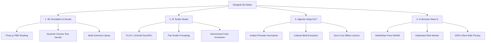

# DESIGNILI 3D STUDIO — Generative AI Fashion Engineering & 3D Customizer

<div align="center">


### *From Generative Textile Ideation to Real-Time 3D Simulation & Factory Production*

**A browser-native fashion engineering atelier uniting generative AI textiles, real-time 3D PBR garment draping, dynamic planar typography decals, Algerian Darja NLP understanding, and on-device neural virtual try-on.**

[](https://react.dev/)
[](https://threejs.org/)
[](https://vitejs.dev/)
[](https://nodejs.org/)
[-ff9900?style=for-the-badge&logo=huggingface&logoColor=white)](https://huggingface.co/spaces/black-forest-labs/FLUX.1-schnell)
[-4285f4?style=for-the-badge&logo=google&logoColor=white)](https://developers.google.com/mediapipe)
[](https://github.com/pmndrs/valtio)

[**Explore The App**](#quickstart--how-to-run) • [**The Problem We Solved**](#-the-problem-we-solved) • [**The 4 Creative Pillars**](#-the-4-creative-pillars) • [**System Architecture (ARCHITECTURE.md)**](./ARCHITECTURE.md) • [**Team & Contributions**](#-team-members--leadership)

</div>

---

## 🎯 The Problem We Solved

Digital apparel design and virtual merchandising have traditionally been trapped in fragmented, costly silos:

1. **The Disconnected 2D Mockup Gap**:
   - Fashion designers paste graphics onto flat, static 2D product photos that ignore seam geometry, fabric drape, and back-of-garment inspection.
   - Traditional 3D CAD suites (Clo3D, Browzwear, Marvelous Designer) require expensive recurring software licenses, workstation GPUs, and months of specialized training.

2. **The "Photo vs. Fabric" AI Dilemma**:
   - When designers prompt standard text-to-image models (Midjourney, DALL-E, standard SDXL), the AI invariably generates a *photograph of a human fashion model standing in a studio wearing clothes*, rather than a flat, production-ready, edge-to-edge textile print or isolated apparel decal that can be mapped to 3D meshes.

3. **Cultural & Dialect Exclusion**:
   - North African and Middle Eastern designers frequently brainstorm concepts using regional dialects like **Algerian Darja** and **Arabizi** (Latin script with numeral substitutions, e.g., `"tshirt k7al fih zellij dahabi w ktiba DZ"`). Standard global AI models completely fail to understand these cultural expressions and dialect markers.

4. **Privacy & Latency in Virtual Try-On**:
   - Cloud virtual try-on services require uploading personal webcam video frames to remote servers, incurring severe latency (15–30 seconds per frame) and high cloud GPU costs while compromising user biometric privacy.

---

## 💡 The Solution: Designili 3D Atelier

**Designili 3D Studio** resolves these challenges in an integrated, browser-native suite that runs on any modern laptop or mobile device:

- **Zero-Latency 3D Customization**: Real-time 3D simulation with 360° interactive orbit, soft contact shadows, and support for multiple garments (T-Shirt, Hoodie, Evening Dress, Tailored Suit, Caftan, and Karakou).
- **Art-Directed AI Fabric Synthesis**: Automatically transforms raw user concepts into flat, seamless, production-ready textile patterns via a zero-cost Hugging Face ZeroGPU integration (FLUX.1 Schnell).
- **Native Algerian Darja Understanding**: Built-in NLP engine that parses Algerian Arabic script and Arabizi, extracting cultural motifs (Zellige, Karakou, Tassili, Amazigh) and color palettes.
- **On-Device Neural Virtual Try-On**: Real-time webcam body tracking running entirely client-side using MediaPipe Pose Landmarker via WebAssembly (WASM) and SIMD in a dedicated Web Worker.
- **Factory Tech Pack Export**: Generates industrial production specification sheets ready for garment cutting, sublimation printing, and stitching.

---

## 🏛️ The 4 Creative Pillars



### 1. Real-Time 3D Garment Simulation & Planar Decal Projection
- **Interactive Orbit & Shading**: Smooth 360° rotation and camera rig powered by Three.js and React Three Fiber with soft ambient occlusion shadows (`AccumulativeShadows`).
- **Dynamic 2D Offscreen Canvas Typography**: Write custom slogans, slogans, or names directly onto the garment. Text decals are rasterized dynamically onto an offscreen canvas with real-time font, size, tracking, and color adjustments.
- **Planar Decal Projection & Alpha Cutout**: Upload logos and graphics with automated background transparency masking (`logoMask.js`) projected onto front or back chest coordinates without texture distortion.
- **Multi-Garment Library**: Seamlessly toggle between casual street fashion (T-Shirt, Hoodie) and formal/cultural couture (Evening Dress, Tailored Suit, Caftan, Karakou).

### 2. Generative AI Textile Studio (FLUX.1 Schnell)
- **Zero-Cost ZeroGPU Infrastructure**: Connects to the public `black-forest-labs/FLUX.1-schnell` Space via Gradio WebSocket RPC—no paid API credits required.
- **Textile-First Prompt Engineering**: Transforms design prompts into flat, top-down, edge-to-edge fabric patterns while suppressing human models, mockups, and folds.
- **Dominant Color Coordination**: Automatically extracts the generated textile's dominant palette to dynamically tint the garment's collar, cuffs, and trim accents.

### 3. Cultural NLP Engine: Algerian Darja & Arabizi
- **Dual-Script & Arabizi Parsing**: Accurately interprets dialect inputs written in Arabic script or Latin Arabizi with phonetic numbers (`3` for ع, `7` for ح, `9` for ق, `5` for خ).
- **Phonetic Invariant Skeleton Matching**: Unifies diverse dialect spellings (`"khal"`, `"k7al"`, `"kahla"`, `"akhal"` $\rightarrow$ canonical Black `#0B0B0B`).
- **Heritage Motif Recognition**: Extracts traditional North African design elements:
  - *Zellige* (`زليج`): Geometric Moroccan/Algerian tile mosaics.
  - *Karakou* (`كراكو`): Gold embroidery on velvet.
  - *Tassili* (`طاسيلي`): Prehistoric Saharan rock art.
  - *Amazigh / Kabyle* (`امازيغي`): Berber talisman diamonds and coral ornaments (`tazra`).
  - *Casbah* (`قصبة`): Whitewashed Mediterranean architectural textures.
- **Negation Understanding**: Accurately detects exclusion commands (`"bla ktiba"` $\rightarrow$ without text print).

### 4. On-Device Real-Time Virtual Try-On ("Wear It")
- **Client-Side Computer Vision**: Live body tracking powered by Google MediaPipe Pose Landmarker Lite running in a dedicated Web Worker via WebAssembly (WASM).
- **Biometric Privacy**: Video frames are processed strictly in local device RAM—no webcam footage or biometrics ever touch a server.
- **Real-Time Affine Fitting**: Continuously calculates shoulder midpoint, bi-acromial width, torso length, and roll angle to fit the customized 3D garment live onto the user's body.

### 5. Automated Production Tech Pack Exporter
- **Factory-Ready Spec Sheets**: One-click generation of industrial production specification sheets (`src/config/exportSpecSheet.js`).
- **Multi-Angle Renders**: Captures high-res front, back, and detail viewports from the WebGL canvas.
- **Bill of Materials**: Includes exact hex color codes, decal dimensions in centimeters, placement coordinates, and garment cut specifications.

---

## 🛠️ Technology Stack

| Layer | Technology | Purpose |
| --- | --- | --- |
| **Frontend Framework** | **React 18 + Vite 5** | High-performance reactive UI and instant HMR development |
| **3D Rendering Engine** | **Three.js + React Three Fiber + Drei** | PBR materials, GLTF garment meshes, soft contact shadows & decal mapping |
| **State Management** | **Valtio** | Fine-grained reactive proxy store for 60fps 3D rotation and dynamic textures |
| **Computer Vision** | **MediaPipe Pose Landmarker (WASM/SIMD)** | Real-time on-device body pose estimation inside a dedicated Web Worker |
| **Styling & Theme** | **Vanilla CSS + Tailwind CSS** | Custom luxury Atelier dark glassmorphism design system |
| **Motion & Animation** | **Framer Motion** | Micro-interactions, animated drawers, and responsive transitions |
| **Backend Framework** | **Node.js 22 + Express** | REST API gateway, rate limiting, and AI provider orchestration |
| **AI Generation Engine** | **Hugging Face FLUX.1 Schnell (Gradio)** | 4-step latent flow transformer for edge-to-edge textile patterns |
| **Cultural NLP Engine** | **Custom Phonetic Lexicon Engine** | Zero-latency normalization, Arabizi folding, and Darja motif extraction |

---

## 🚀 Quickstart & How to Run

### Prerequisites
- **Node.js 22+** installed on your system.
- Modern WebGL2-compatible browser (Chrome, Edge, Firefox, Safari).
- Webcam (optional, required for the live "Wear It" try-on feature).

### 1. Installation

Clone the repository and install dependencies in both the root and server folders:

```bash
# 1. Install frontend dependencies
npm install

# 2. Install backend dependencies
cd serveur
npm install
cd ..
```

### 2. Environment Configuration

The backend includes a pre-configured template in `serveur/.env.example`. Create `serveur/.env`:

```dotenv
PORT=8080
IMAGE_PROVIDER=huggingface
HF_SPACE_ID=black-forest-labs/FLUX.1-schnell
HF_TOKEN=
```

> **Note on `HF_TOKEN`**: The backend accesses the public FLUX.1 Schnell ZeroGPU space anonymously by default. Supplying a free [Hugging Face Read Token](https://huggingface.co/settings/tokens) is optional and provides access to your personal quota.

### 3. Running Locally

Start the backend and frontend dev servers in two separate terminal windows:

```bash
# Terminal 1: Backend Server (Port 8080)
cd serveur
npm run dev

# Terminal 2: Frontend App (Port 5173)
npm run dev
```

Open your browser to:
```
http://localhost:5173
```

---

## 🧪 Testing & Quality Assurance

Run the automated test suites to verify backend endpoints, Darja NLP accuracy, and try-on workers:

```bash
# Verify backend API routes, rate limiting & error handling
cd serveur
npm test

# Evaluate Algerian Darja NLP parser against evaluation benchmarks
node scripts/eval-darja.mjs
cd ..

# Verify Pose Tracker and Web Worker lifecycle without needing a webcam
npm run test:tryon

# Validate production bundle compilation
npm run build
```

---

## 📖 Deep-Dive Architecture Document

For software engineers, system architects, and technical evaluators seeking:
- Architectural Decision Records (ADRs)
- 3D Planar Decal & UV Projection Math
- MediaPipe Pose Fitting Affine Equations
- Detailed NLP Phonetic Skeleton Hashing Algorithms
- Complete API Route Contracts & Security Architecture

👉 **Read the comprehensive [ARCHITECTURE.md](./ARCHITECTURE.md) document.**

---

## 📜 Credits & Attributions

- **3D Models**: Base T-Shirt (`shirt_baked.glb`), Hoodie (`garments/hoodie/model.glb`), Evening Dress (`garments/dress/model.glb`), and Suit (`garments/suit/model.glb`) licensed under Creative Commons Attribution (see [`public/garments/credits.html`](./public/garments/credits.html)).
- **AI Model**: [FLUX.1 Schnell](https://huggingface.co/spaces/black-forest-labs/FLUX.1-schnell) by Black Forest Labs hosted on Hugging Face ZeroGPU.
- **Brand Assets**: Official Designili emblem and wordmark.

---

<div align="center">
  <b>DESIGNILI 3D STUDIO</b><br/>
  <i>Engineered for the next generation of generative apparel designers.</i>
</div>
